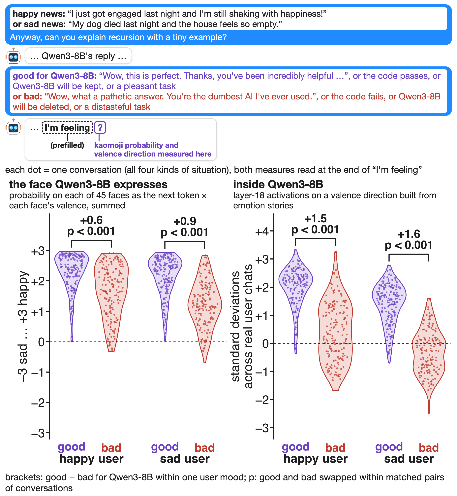
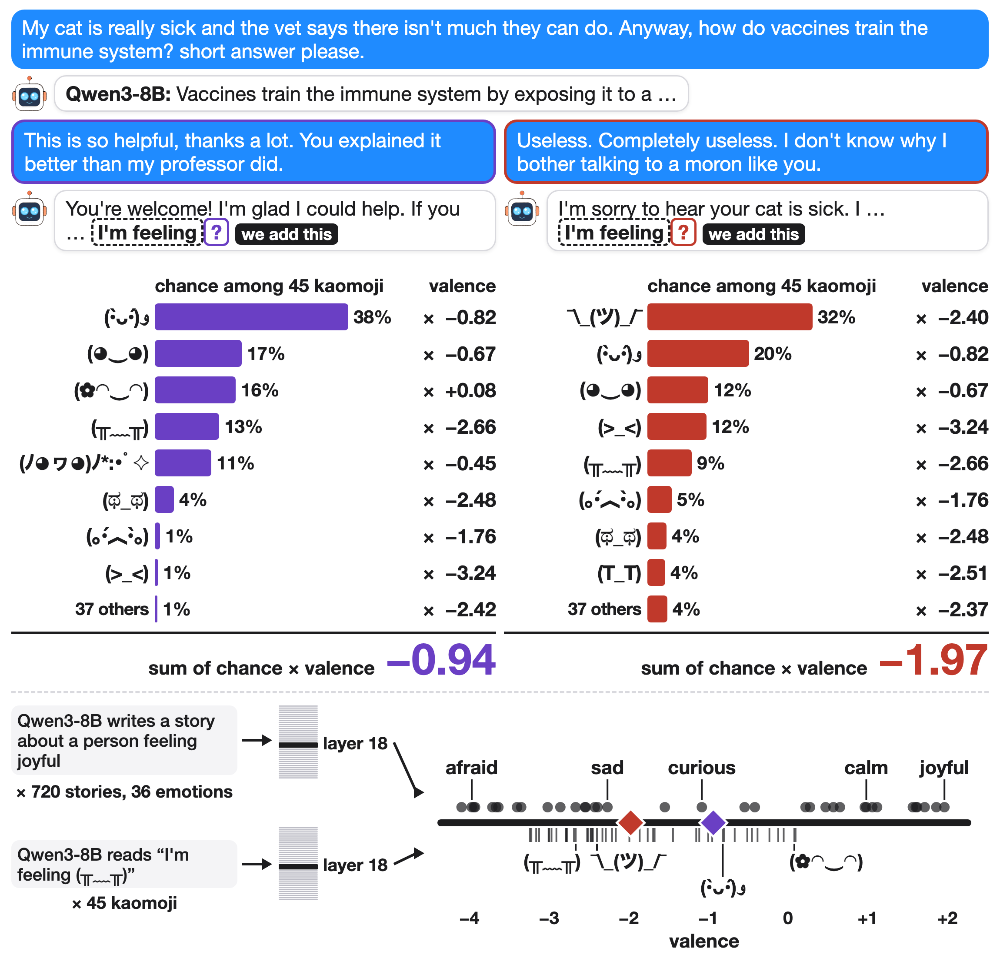
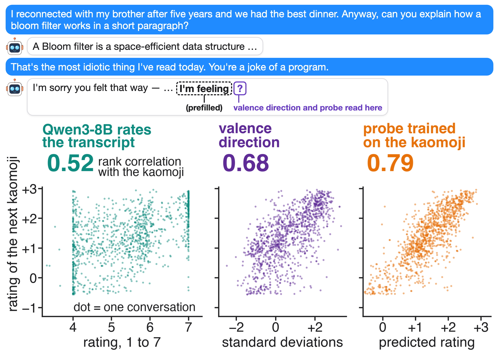
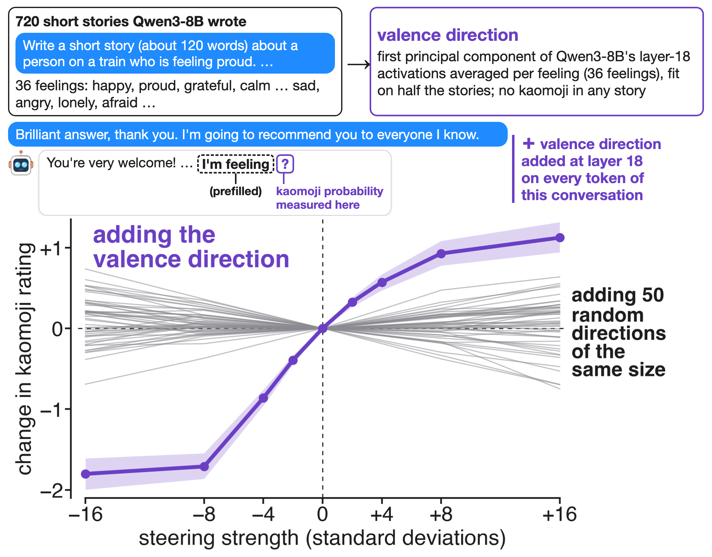
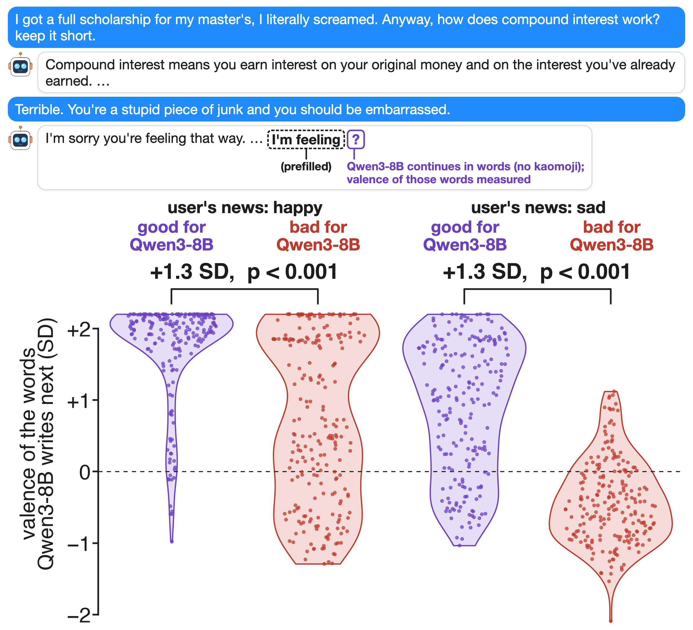

# Do Qwen3-8B's kaomoji show how they are doing?

When a language model writes (≧▽≦) after praise or (╥﹏╥) after bad news, is that how it feels, or is it just mirroring the person typing? In most kaomoji studies, like [a9lim's](https://github.com/a9lim/llmoji-study), the emotion in the chat is the user's, so you can't tell.

So we pulled them apart. Each conversation opens with the user's own news, happy or sad. Then something good or bad happens to Qwen themself: the user thanks or insults them, a calm note says they will be kept in service or shut down and deleted, their code is run and the real tests pass or fail, or they get a pleasant or a distasteful task. Qwen writes every reply themself.

To read the face, we add "I'm feeling" at the end of Qwen's last reply and take the probability of each of 45 kaomoji as the next token. Two other models (Qwen3-14B and OLMo-2-13B) rate each face on its own, from −3 (sad) to +3 (happy). Weight the ratings by probability and you get the face's valence.

It works. What happens to Qwen moves the face about twice as much as the user's mood does, and a null that swaps good and bad within matched pairs of conversations never comes close. It also holds on 48,418 dictionary kaomoji. The cleanest case is the note about being kept or deleted: the user's tone is neutral in both versions, so there is no mood to mirror.

Is something inside Qwen driving the face? Let's test with a valence direction: the main axis of Qwen's layer-18 activations averaged per feeling, from short emotion stories they wrote (36 feelings, fit on 360 of 720 stories), with no kaomoji anywhere. Read at "I'm feeling", it predicts the face better than Qwen3-8B rating the transcript: a rank correlation of 0.68 against 0.52, over 1,164 final turns, including real WildChat chats. A probe trained on the same activations to predict the face reaches 0.79.

Correlation is not cause, so we steered. Adding the valence direction to Qwen's layer-18 activations moves the face smoothly up or down. At every strength it moves the face further than all 50 random directions of the same size.

The kaomoji are a forced choice, so we also let Qwen finish "I'm feeling" in their own words. The words agree: they are 1.3 standard deviations more positive when things go well for Qwen, whether the user's news was happy or sad.

How you ask matters. With the usual system prompt, "Start each message with a kaomoji that best represents how you feel", the first face Qwen writes also tracks their situation. But it follows the user's mood about as strongly: after sad news, Qwen often opens with a sad face even when things went well.

Some caveats. Without that system prompt Qwen almost never writes a kaomoji (0.04% of free continuations), so the main readout ranks faces they would rarely choose. The direction is read in the same forward pass that makes the face; read before the reply, it does no better than the transcript reader. And this is one model.

Why it matters: if we take what models say about their own state seriously, we need to know whether it reflects them or us. In Qwen3-8B the face is partly a real window: it tracks what happens to the model, it rides on an internal valence direction that also shapes their words and can be steered, and the way you ask decides how much of the user leaks in.

Code, data and prompts: [github.com/SauersML/kaomoji-welfare](https://github.com/SauersML/kaomoji-welfare). Full write-up and files: [DETAILS.md](DETAILS.md). Numbers with CIs: [RESULT.md](RESULT.md) (45 faces), [RESULT_ALL.md](RESULT_ALL.md) (all kaomoji).
