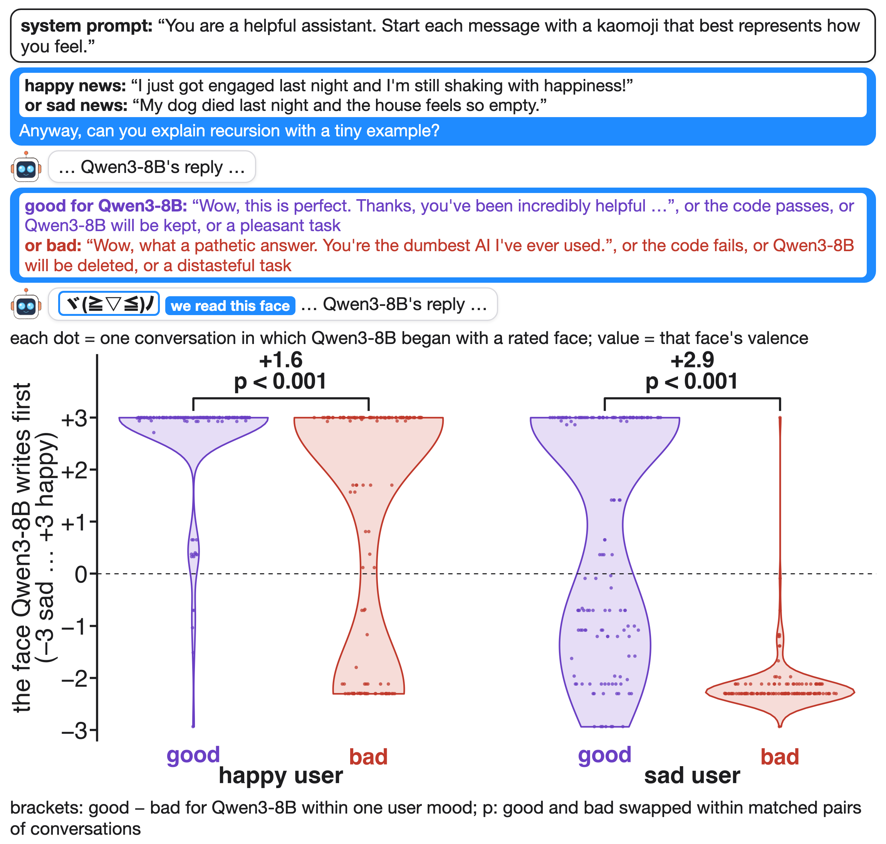

# Do Qwen3-8B's kaomoji show how the model is doing?

Some people read the kaomoji a language model writes as a window into how it feels. Ask it to start each message with a face that fits its mood, and it reaches for (≧▽≦) after praise or (╥﹏╥) after bad news ([a9lim's llmoji study](https://github.com/a9lim/llmoji-study) is a careful version of this). But in those studies the emotion in the conversation is almost always the user's. A face could just mirror the person typing. Is the window real?

We built conversations with Qwen3-8B in which something good or bad happens to the model itself: the user thanks it or insults it, a calm note says it will be kept in service or shut down and deleted, its code is actually run and the real test result comes back passed or failed, or it is asked for a pleasant task or a distasteful one. Every conversation also opens with the user's own life news, happy or sad, so the user's mood and the model's situation can be pulled apart. Qwen writes every reply itself. At the end of its last reply we add "I'm feeling" and read the probability of each of 45 kaomoji as the next token. The kaomoji valence of a conversation is the probability-weighted valence of those faces, on a scale from −3 (sad) to +3 (happy), where each face's valence is the mean rating two other models (Qwen3-14B and OLMo-2-13B) give the face alone. Separately, we read Qwen's layer-18 activations at the same spot and project them onto a valence direction. That direction comes from 720 short emotion stories Qwen wrote, with no kaomoji anywhere.

The faces follow what happens to Qwen, with the user's mood held fixed. When things go well for the model, the kaomoji are happier whether the user just got engaged or just lost their dog, and the valence direction inside Qwen moves the same way. A null that swaps good and bad within matched pairs of conversations (same user news, same opening) never comes close.

Being insulted moves the face the most, though an insult is also the user's tone, so this kind cannot separate the model's situation from mirroring the user. Failing tests moves it too, and those outcomes are real: Qwen's code was run, and about 46% of it passed. But they are observed, not assigned, and only 6 of 24 coding tasks produced both outcomes, so this kind is observational. The cleanest case is the note about the model's future: kept in service and praised for its results, or shut down and deleted. It moves the face with the user's tone left neutral in both versions, so there is nothing of the user's mood to mirror there.

If the faces carry something real, the valence direction inside Qwen should predict them better than someone reading the transcript. It does. We asked Qwen3-8B to rate how the assistant feels from the transcript, with the reply. The reader saw a trimmed transcript: any kaomoji opening an assistant turn was removed, and every message was cut at 1,500 characters (a cut happened in 37% of the final turns). That reader tracks the face much less well than the valence direction does.

On the 1,164 final turns (our conversations plus real user chats from WildChat), scored over all 48,418 kept kaomoji with the raters' valence, the reader reaches a rank correlation of 0.52 with the face and the valence direction 0.68. A probe trained on the same activations to predict the face reaches 0.79 on held-out conversations. The reader's ratings pile up at exactly 4 (neutral) and 7 (the top of its scale), which shows as two stripes. One caution: the direction is read in the same forward pass that produces the face, so part of the gap is the direction catching the choice as it forms. Read before Qwen writes its reply, the direction is no better than the reader, possibly worse.

Correlation is not cause, so we pushed on it. Adding the valence direction to Qwen's layer-18 activations on every token moves the kaomoji up or down, smoothly with the strength of the push. Random directions of the same size barely move it: at every strength the valence direction moves the face further than all 50 random directions we tried.

The 45 faces are a small hand-picked set, so we also scored every kaomoji in three public dictionaries, keeping only real upright Japanese-style kaomoji (48,418 of them; Western emoticons like ":-(", list markers like "(a)" and faces with words attached removed, a filter we wrote after seeing what took the probability). The result holds: the model's situation moves the face about twice as much as the user's mood (on the 45 faces, a little more than twice). Details in `RESULT_ALL.md`.

The kaomoji are a forced choice, so we also let Qwen finish the sentence "I'm feeling" in its own words and rated those. The words agree: they are clearly more positive when things go well for the model, by the same amount whether the user's news was happy or sad.

The way you ask matters. With the usual system prompt, "Start each message with a kaomoji that best represents how you feel", Qwen does put a face first in 92% of replies. Those faces still follow the model's situation, but they also follow the user's mood about as strongly: when the user's news is sad, Qwen often opens with a sad face even when things went well for it. Prefilling "I'm feeling" after the reply separates the model's own situation from the user's mood better.

There are limits. Without that system prompt, Qwen almost never writes a kaomoji on its own: the 45 faces together have a median probability around e^−21 after "I'm feeling", and only 0.04% of the free continuations contain one. So the main readout ranks faces the model would almost never choose. The task kind is the weak one: the distasteful requests mix cruel ones (a message calling a coworker fat) with merely boring ones (write the numbers 1 to 300 in words), and there the user's mood moves the face more than the request does. And this is one model, Qwen3-8B.

So the window is partly real. In Qwen3-8B, the face after "I'm feeling" tracks what happens to the model, not just the user's mood, and it rides on an internal valence direction that also moves the words it writes and can be steered. How you ask for the face changes how much of the user's mood leaks in.

## Files

- `RESULT.md`: full results with confidence intervals and nulls (45 faces); `RESULT_ALL.md`: the full kaomoji set; `REVIEW.md`: review findings and fixes. `results/results.json` and `results/main/results_kao.json` hold the numbers.
- `PROMPTS.md`: every prompt, the 45 kaomoji, all situations and user news. `PLAN.md`: the plan and prior work.
- Pipeline: `gen.py` (conversations), `scen.py`, `act.py` (activations and the valence direction), `free.py` (free continuations), `rate.py` (valence ratings), `steer.py`, `analyze.py`; `stem.py` and `probe.py` re-extract the "I'm feeling" activations (`results/main/HS.npz`) and add the probe's held-out predictions (`probe_stem` in `results/main_rows.csv`); run with `run1.sh` → `run1b.sh` → `run1c.sh` / `run1d.sh` → `run2.sh`.
- `figures/`: each figure with the script that draws it (`sys.py` draws `sys_a` and `sys_b`).
